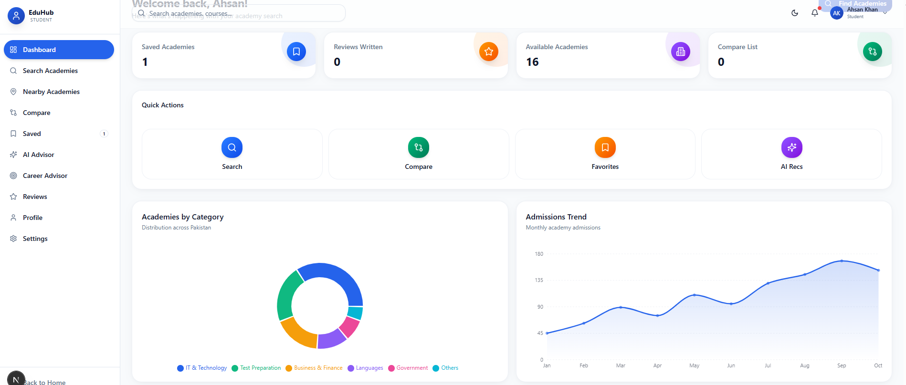
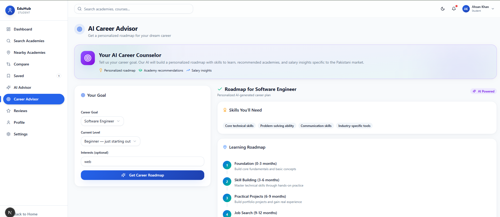

# EduHub Pakistan — AI-Powered Education Discovery Platform

A production-quality full-stack MERN-style web application where students discover academies across Pakistan, compare courses/fees/ratings, get AI-powered recommendations, and academy owners manage their complete academy digitally.

## Screenshots

| Home page | Sign-in |
|---|---|
|  |  |

| Student dashboard | Career advisor |
|---|---|
|  |  |

## Tech Stack

**Frontend**
- React 19 + TypeScript
- Next.js 16 (App Router)
- Tailwind CSS 4 + shadcn/ui
- Framer Motion (animations)
- Recharts (charts)
- TanStack Query (server state)
- Lucide React (icons)

**Backend**
- Next.js API Routes
- Prisma ORM (SQLite — swappable to PostgreSQL/MongoDB)
- JWT authentication (httpOnly cookies)
- bcrypt password hashing

**AI**
- z-ai-web-dev-sdk (GLM LLM) for 4 AI features

**Storage**
- Local file uploads (`/public/uploads/`)

## Features

### 4 User Roles
- **Student** — search, compare, save, review academies; AI advisor & career advisor
- **Academy Owner** — manage students, teachers, courses, fees, admissions, scholarships, announcements, gallery, reviews, analytics
- **Teacher** — view only assigned students, mark attendance, track progress
- **Admin** — manage all academies, categories, students, teachers, reviews, reports, analytics

### 4 AI Features
1. **Academy Recommendation** — personalized matches based on budget, city, course, career goal
2. **Smart Comparison** — AI explains which academy is better and why
3. **Career Advisor** — skills, learning roadmap, best academies, career opportunities
4. **Review Summarizer** — AI summarizes all student reviews for an academy

### Additional
- Beautiful loading splash screen (first visit only)
- Dark / Light mode
- Real image uploads (logos, gallery, avatars)
- Glassmorphism UI with premium gradients
- Skeleton loading states, error states, empty states
- Toast notifications
- CSV export from data tables
- Pagination, search, filtering, sorting
- Mobile responsive
- Lazy-loaded dashboard pages (code splitting)
- Google Maps placeholder with "View on Google Maps" link

## Database Models (14)

User, Academy, Teacher, Student, Course, Review, Announcement, Admission, Inquiry, Notification, Favorite, AIRecommendation, Scholarship, Category

## Getting Started

### Prerequisites
- Node.js 18+ or Bun
- npm or bun

### Installation

```bash
# Unzip the project
unzip eduhub-pakistan.zip
cd eduhub-pakistan

# Install dependencies
bun install
# or: npm install

# Generate Prisma client & create database
bun run db:push
# or: npx prisma db push

# Seed the database with sample data
bun run scripts/seed.ts
# or: npx tsx scripts/seed.ts

# Start the dev server
bun run dev
# or: npm run dev
```

Open **http://localhost:3000** in your browser.

## Demo Credentials

| Role     | Email             | Password |
|----------|-------------------|----------|
| Student  | student@eduhub.pk | 123456   |
| Academy  | academy@eduhub.pk | 123456   |
| Teacher  | teacher@eduhub.pk | 123456   |
| Admin    | admin@eduhub.pk   | 123456   |

## Sample Data

The seed script populates:
- 16 academies (Corvit, Aptech, NAVTTC, EVS, Educators, NICON, PNY, Beaconhouse, Saylani, Arena, PIA, LUMS Language, Preston, KIPS, CodeWithHarry, Aitchison)
- 28 courses
- 27 reviews
- 8 scholarships
- 8 categories
- Teachers, students, announcements, admissions, inquiries, notifications, favorites

## Project Structure

```
├── prisma/
│   └── schema.prisma          # 14 database models
├── scripts/
│   └── seed.ts                # Database seed script
├── src/
│   ├── app/
│   │   ├── api/               # 30+ REST API routes
│   │   │   ├── auth/          # login, signup, logout, me
│   │   │   ├── academies/     # CRUD + filters
│   │   │   ├── students/      # CRUD
│   │   │   ├── teachers/      # CRUD
│   │   │   ├── courses/       # CRUD
│   │   │   ├── reviews/       # CRUD
│   │   │   ├── announcements/ # CRUD
│   │   │   ├── admissions/    # CRUD
│   │   │   ├── inquiries/     # CRUD
│   │   │   ├── scholarships/  # CRUD
│   │   │   ├── categories/    # CRUD
│   │   │   ├── favorites/     # toggle
│   │   │   ├── notifications/ # list + mark read
│   │   │   ├── upload/        # image upload
│   │   │   ├── ai/            # recommend, compare, career, summarize
│   │   │   ├── admin/         # stats, reset
│   │   │   └── teacher/       # scoped students
│   │   ├── globals.css
│   │   ├── layout.tsx
│   │   └── page.tsx           # Main router
│   ├── components/
│   │   ├── landing/           # Landing page sections
│   │   ├── auth/              # Login/Signup
│   │   ├── student/           # Student dashboard + pages
│   │   ├── academy/           # Academy dashboard + pages
│   │   ├── teacher/           # Teacher dashboard
│   │   ├── admin/             # Admin dashboard + pages
│   │   ├── search/            # Academy details
│   │   ├── common/            # Reusable UI (StatCard, DataTable, Charts, etc.)
│   │   ├── layout/            # Dashboard layout
│   │   └── ui/                # shadcn/ui components
│   ├── context/               # AppContext, ThemeProvider, QueryProvider
│   ├── lib/                   # db, auth, ai, api-client, hooks, utils, types
│   └── hooks/                 # use-toast, use-mobile
├── public/
│   └── uploads/               # Uploaded images
├── db/
│   └── custom.db              # SQLite database
├── .env                       # Environment variables
├── package.json
├── tailwind.config.ts
├── tsconfig.json
└── next.config.ts
```

## Available Scripts

| Command                   | Description                              |
|---------------------------|------------------------------------------|
| `bun run dev`             | Start dev server (http://localhost:3000) |
| `bun run lint`            | Run ESLint                               |
| `bun run db:push`          | Push Prisma schema to database           |
| `bun run db:generate`      | Generate Prisma client                   |
| `bun run db:migrate`       | Run migrations                           |
| `bun run db:reset`         | Reset database                           |
| `bun run scripts/seed.ts`  | Seed database with sample data           |

## Environment Variables

Create a `.env` file in the root:

```env
DATABASE_URL="file:./db/custom.db"
JWT_SECRET="your-secret-key-change-in-production"
```

## API Overview

All API routes are under `/api/` and follow REST conventions:

- **Auth**: JWT in httpOnly cookies, bcrypt password hashing
- **Authorization**: Role-based (`student`, `academy`, `teacher`, `admin`)
- **Response format**: `{ success: boolean, data: any }` or `{ success: false, error: { message, code } }`
- **Pagination**: `?page=1&limit=20`
- **Filtering**: Query params (e.g., `?city=Lahore&category=IT`)
- **Search**: `?search=keyword`

## Deployment

The app uses SQLite by default. For production:

1. **Database**: Swap `DATABASE_URL` in `.env` to PostgreSQL or MongoDB
2. **Storage**: Replace local uploads with Cloudinary/AWS S3 (update `/api/upload` route)
3. **Maps**: Add `NEXT_PUBLIC_GOOGLE_MAPS_API_KEY` for real Google Maps integration
4. **Deploy**: Vercel, Netlify, or any Node.js hosting

## License

This project is built for educational/hackathon purposes.

---

Built with ❤️ in Pakistan

Updated for Hackathon Submission - Oct 29 2026

